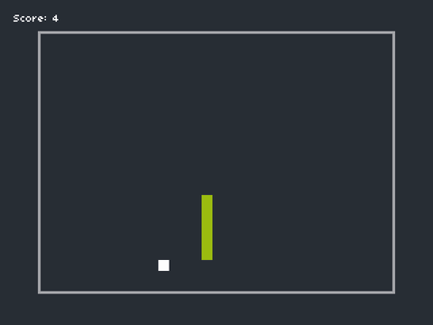

<div align="center">

# 🐍 Tiny Snake

**A small, retro Snake game built with [LÖVE](https://love2d.org) and Lua.**




</div>

## Play

Install [LÖVE 11](https://love2d.org), then run from the repository root:

```bash
love .
```

| Key        | Action          |
| ---------- | --------------- |
| `Enter`    | Start / confirm |
| Arrow keys | Steer the snake |
| `Esc`      | Quit            |

## How it works

The game renders at 320×240 and is scaled up 3× with [push](https://github.com/Ulydev/push) for crisp pixel art.
A small **state stack** (`game.lua`) moves between `title → countdown → play → score`.

- **Ticks, not frames:** the snake advances one grid cell every 0.25s, whatever your display's refresh rate.
- **Growth:** on each tick the head moves forward. When the snake eats, it keeps its tail segment instead of
  dropping it.
- **Food** spawns on a random free cell in the `Room` grid, never on the snake's body.
- **Game over** when the head leaves the room or hits the snake's own body.

```
main.lua              entry point and LÖVE callbacks
game.lua              state stack
elements/snake.lua    movement, growth, collision helpers
elements/room.lua     playfield grid, random cell placement
elements/food.lua     food
states/*.lua          title, countdown, play, score
assets/               font and sound effects
```
